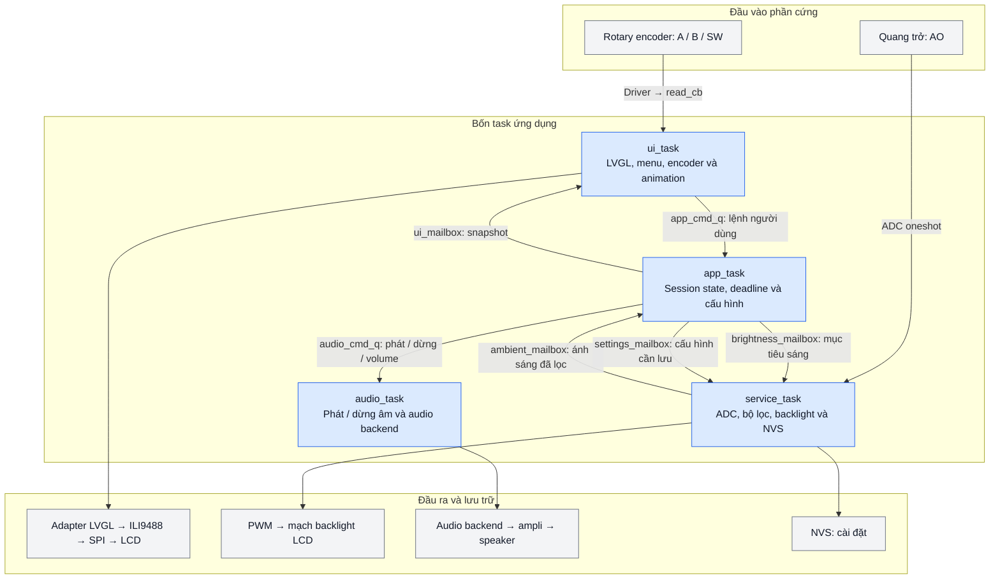
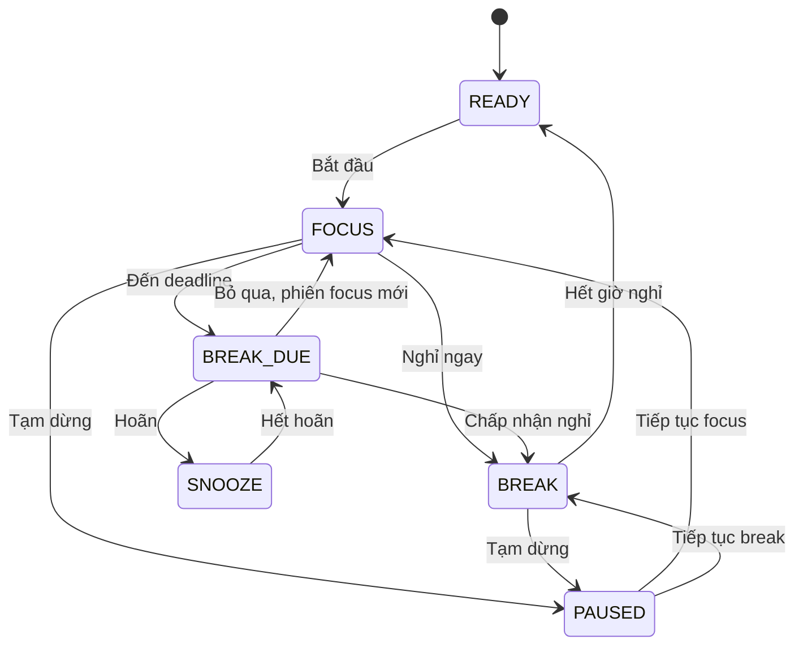
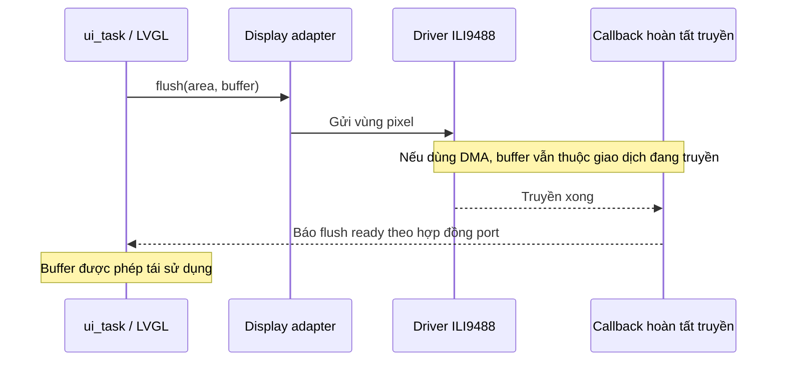

# Deskmoo — Kế hoạch kiến trúc firmware prototype

Ngày cập nhật: 30/10/2026. Trạng thái: thiết kế đề xuất, chưa triển khai firmware trong workspace này.

Mục tiêu: companion để bàn phong cách retro, điều khiển hoàn toàn bằng encoder xoay có nhấn. Khi focus, màn hình vẫn giữ cảnh và animation nhẹ, giảm backlight theo môi trường. Người phát triển tự làm UI/Aseprite và firmware, khoảng 18 giờ/tuần. Ngân sách prototype dưới 5 triệu đồng, giá bán mục tiêu khoảng 1 triệu đồng; giá thành cần kiểm chứng bằng BOM và báo giá.

## 1. Phần cứng và giả định

| Thành phần | Đã biết | Quyết định firmware |
|---|---|---|
| MCU | ESP32-S3 | ESP-IDF + FreeRTOS; xác nhận RAM, PSRAM, flash của board thực tế |
| LCD | SPI 3.5 inch, ILI9488; đã có driver chạy được | Bọc driver hiện tại bằng adapter LVGL; bố cục mục tiêu 480×320 ngang |
| Điều khiển | Rotary encoder có nhấn | A/B/SW → driver encoder → input LVGL |
| Ánh sáng | Module quang trở bốn chân | Giả định VCC/GND/AO/DO; dùng AO → ADC, xác nhận theo module |
| Âm thanh | Speaker chưa chọn mã | Interface độc lập; backend đề xuất I²S + ampli + loa thụ động |
| Nguồn | USB | Điều khiển backlight PWM qua mạch phù hợp với module LCD |

Cần xác nhận trước khi chốt pin map:

- Sơ đồ board, chân đang dùng cho flash/PSRAM/USB và các chân dành riêng.
- Điện áp AO và dải ADC; bảo đảm tín hiệu nằm trong giới hạn cho phép.
- Driver ILI9488 đang blocking hay DMA, định dạng màu đầu vào và dữ liệu truyền SPI.
- Khả năng điều khiển backlight của module LCD.
- Loa, ampli, nguồn cấp và chân audio.

## 2. Sơ đồ bốn task

Driver/ISR cung cấp dữ liệu hoặc hoàn tất giao dịch; app quyết định trạng thái sản phẩm.



| Task | Sở hữu | Nhận | Thực hiện / phát ra |
|---|---|---|---|
| app_task | Session, deadline, cấu hình runtime, brightness policy | Lệnh UI, mức sáng đã lọc | Snapshot UI, yêu cầu audio/backlight/lưu cấu hình |
| ui_task | Widget LVGL, focus/menu, input callback, animation | Encoder, snapshot app | Render, gửi lệnh có nghĩa sang app |
| service_task | ADC, bộ lọc, PWM, ghi NVS | Mục tiêu sáng, bản cấu hình cần lưu | Đọc/lọc ánh sáng, fade backlight, lưu cấu hình |
| audio_task | Audio peripheral, buffer phát, ampli | Phát/dừng/volume | Cấp dữ liệu audio, báo lỗi nếu cần |

Quy tắc sở hữu:

- Chỉ ui_task gọi các API LVGL thông thường; task khác gửi message, không sửa widget.
- Ngoại lệ callback hoàn tất flush được giải thích tại mục 6; không cho phép gọi LVGL tùy ý từ ISR.
- Chỉ app_task thay đổi session state. UI giữ trạng thái điều hướng riêng.
- Module không đồng nghĩa với task: session và brightness policy là module được gọi trong app_task.
- Task có thời gian chờ, tránh busy-wait. Core affinity, priority và stack chốt sau khi đo tải thực tế.

## 3. Queue, mailbox và hợp đồng dữ liệu

Dung lượng dưới đây là cấu hình khởi đầu, cần đo khi chạy tích hợp.

| Kênh | Hướng | Ban đầu | Quy tắc |
|---|---|---|---|
| app_cmd_q | UI → App | Queue 32 | Lệnh có thứ tự; kiểm tra kết quả gửi, không bỏ âm thầm |
| ambient_mailbox | Service → App | Queue 1 | Ghi đè mẫu mới nhất: giá trị, validity, timestamp |
| ui_mailbox | App → UI | Queue 1 | Snapshot mới nhất; dữ liệu sao chép, không có con trỏ widget |
| brightness_mailbox | App → Service | Queue 1 | Mức sáng mục tiêu mới nhất và thời gian fade |
| settings_mailbox | App → Service | Queue 1 | Bản cấu hình đầy đủ mới nhất, kèm revision |
| audio_cmd_q | App → Audio | Queue 8 | Âm nhắc ưu tiên hơn âm phụ; STOP/MUTE có đường xử lý ưu tiên |

App có thể chờ app_cmd_q với timeout tối đa khoảng 50 ms trong bản đầu; sau khi thức, đọc ambient_mailbox và kiểm tra deadline. Đây là thông số thử nghiệm, chưa phải bảo đảm thời gian thực cứng.

Snapshot UI gồm session state, deadline hoặc thời gian còn lại khi pause, cấu hình cần hiển thị và revision. Nhận snapshot mới không được làm mất mục menu người dùng đang chọn. Tính toán countdown hiển thị dựa trên bản sao deadline; UI không sửa model của app.

Nếu app_cmd_q đầy, UI cần báo thất bại/đang bận và ghi log; không giả định lệnh đã thành công. Mailbox chỉ dùng cho dữ liệu mà bản mới thay được bản cũ.

## 4. Session state và timer



- Menu/settings/animation là UI state riêng, không thay thế session state.
- Dùng đồng hồ monotonic, ví dụ esp_timer_get_time(). Thời gian còn lại tính từ deadline, không giảm biến theo frame hoặc mỗi lần task thức.
- PAUSED giữ resume_state và thời gian còn lại; chỉ tiếp tục đúng trạng thái đã pause.
- Mở menu không tự pause. Đổi thời lượng áp dụng cho phiên kế tiếp.
- Không phản hồi BREAK_DUE: giảm mức thu hút sau một khoảng thời gian, giữ trạng thái chờ; không tự ghi nhận đã nghỉ, không lặp âm vô hạn.
- Âm báo phát theo sự kiện chuyển trạng thái, không phát theo từng snapshot/UI refresh.
- Reboot: nạp cài đặt hợp lệ, về READY. Không dùng lại deadline monotonic của lần chạy trước.

## 5. Encoder và điều hướng

Luồng: A/B/SW → driver encoder → LVGL input/group → UI command → app_task.

- Chuẩn hóa một nấc vật lý thành một bước UI; xử lý dội tiếp điểm.
- Có thể dùng PCNT cho A/B; kiểm tra dội cơ học, không coi glitch filter là toàn bộ giải pháp chống dội.
- Giữ được thứ tự nhấn/thả và các bước xoay đến khi UI đọc; tránh mất click ngắn giữa hai lần polling.
- Xoay để chuyển mục/chỉnh giá trị; nhấn ngắn chọn/xác nhận; nhấn giữ quay lại/thoát chỉnh sửa.
- Sau nhấn giữ, thả nút không gây thêm một lệnh chọn ngắn ngoài ý muốn.
- Nhắc nghỉ mặc định chọn Nghỉ ngay, tiếp theo là Hoãn và Bỏ qua.

App chỉ nhận lệnh có nghĩa: START_FOCUS, PAUSE, RESUME, START_BREAK, SNOOZE, SKIP_BREAK, UPDATE_SETTINGS. Không phát đồng thời nút nhấn thô tới cả UI và app.

## 6. LCD, callback và bộ nhớ

Tái sử dụng driver ILI9488 hiện tại, thêm adapter LVGL. Hợp đồng quan trọng là thời điểm buffer được phép dùng lại.



- Driver blocking: báo flush ready sau khi hàm truyền hoàn tất.
- Driver DMA: giữ buffer hợp lệ đến callback hoàn tất; không báo sớm, không đi vòng qua app_task.
- Callback ISR chỉ làm việc được port/LVGL cho phép, ví dụ báo flush ready. Không tạo widget, đọc ADC, ghi NVS hoặc phát audio trong ISR.
- Bắt đầu bằng partial rendering, hai strip buffer. RGB565 với hai buffer 480×40×2 byte cần tổng cộng 75 KiB, chưa tính chuyển đổi màu/buffer khác.
- Bố trí buffer theo yêu cầu DMA của driver và ESP-IDF; PSRAM nếu có dùng cho cache/asset phù hợp. Không mặc định mọi vùng PSRAM đều dùng trực tiếp cho mọi DMA.
- Chốt định dạng màu trong RAM và dữ liệu truyền theo driver hiện tại.
- Nền tĩnh, mascot/chữ cập nhật vùng thay đổi. Đo thời gian render và truyền trước khi chốt FPS.

## 7. Quang trở và backlight

Pipeline: AO → ADC → lọc nhiễu → mức sáng tương đối → brightness policy → PWM.

- Đọc ADC oneshot khoảng 10 lần/giây; có thể lấy nhiều mẫu và làm mượt EMA.
- Hiệu chỉnh theo mức tối/sáng đo trên module, xác nhận chiều tăng/giảm tín hiệu. Chưa quy đổi thành lux.
- App kết hợp ánh sáng môi trường, session state và cài đặt để tính mục tiêu sáng; service thực hiện PWM/fade.
- Cập nhật mục tiêu khoảng 1–2 lần/giây, có hysteresis; thử fade khoảng 0,5–1,5 giây.
- Focus giữ mức tối thiểu đủ nhìn. Nhắc nghỉ tăng sáng có giới hạn theo môi trường/cấu hình.
- Đặt sensor tránh ánh LCD chi phối. Khi đọc lỗi hoặc mẫu quá cũ, dùng brightness manual/fallback.
- ADC sát biên chưa đủ kết luận sensor hỏng; có thể là môi trường thực sự rất sáng/tối.

## 8. Audio và cài đặt

Audio interface: PLAY(sound_id), STOP, SET_VOLUME, MUTE. Chốt backend sau khi chọn loa/ampli; hướng ban đầu I²S + ampli + loa thụ động. Loa không nối trực tiếp GPIO.

- Vài clip ngắn, một âm tại một thời điểm. Audio task cấp dữ liệu; UI/app không phát blocking.
- Người dùng xác nhận thì dừng âm tương ứng. Dùng ID/revision lượt nhắc để bỏ yêu cầu cũ chưa phát sau khi đã xác nhận.
- Queue bận: âm phụ được phép bỏ. STOP/MUTE dùng control mailbox hoặc task notification ưu tiên, không chờ hết hàng âm.
- Audio lỗi: ghi log, vẫn nhắc bằng hình ảnh.

NVS lưu thời lượng focus/nghỉ/hoãn, brightness mode/manual, volume/mute và thông số hiệu chỉnh ánh sáng. Nạp trước khi chạy phiên; sau khởi động, service_task sở hữu ghi NVS.

- App gửi cấu hình đầy đủ kèm revision. Service giữ bản mới nhất, lưu sau khoảng yên 1–2 giây.
- Không ghi theo countdown, frame hoặc từng mẫu ADC.
- Chỉ đánh dấu revision đã lưu sau khi ghi thành công. Lỗi ghi có log/báo trạng thái và retry giới hạn.
- Có schema version, kiểm tra phạm vi; dùng mặc định nếu dữ liệu không hợp lệ.

## 9. Cấu trúc module đề xuất

Các tên dưới đây là cấu trúc dự kiến, chưa phải các file firmware đã tạo.

```text
main/ Khởi tạo, ghép module
components/
 board/ Pin map, thông số board, thứ tự init
 display/ Adapter LVGL + driver ILI9488 hiện có
 encoder/ A/B/SW, chống dội, chuẩn hóa nấc, input adapter
 ambient/ ADC và bộ lọc quang trở
 backlight/ PWM và fade
 app/ Session, deadline, command, brightness policy
 ui/ Screens, menu, mascot, LVGL task, asset
 audio/ Audio task, command, backend
 settings/ Schema, validation, NVS
 services/ Service task và mailbox liên quan
```

Aseprite tạo asset nền/mascot và bố cục; LVGL dựng timer, chữ động, menu và trạng thái được chọn. Logic session độc lập với API LVGL/driver để kiểm tra chuyển trạng thái mà không cần LCD.

## 10. Lộ trình triển khai và kiểm tra

| Mốc | Công việc | Điều kiện hoàn thành |
|---|---|---|
| 1 | LVGL + driver ILI9488 | Đúng màu/hướng/vùng; hợp đồng flush và buffer rõ ràng |
| 2 | Encoder + menu | Một nấc đúng một bước, không mất click, long press không chọn nhầm |
| 3 | Session + mailbox | Focus, pause/resume, nghỉ, hoãn, skip đúng cả demo nhanh và thời gian thật |
| 4 | ADC + backlight | Sáng tự đổi êm, không dao động, focus vẫn rõ |
| 5 | Audio + NVS | Âm đúng một lần/lượt nhắc; STOP/MUTE hiệu lực; cài đặt giữ sau reboot |
| 6 | Tích hợp | Render, input, ADC, audio và lưu cấu hình hoạt động đồng thời ổn định |

Kiểm tra trọng tâm:

- Chạy khoảng 8 giờ; theo dõi reset, heap/stack, lỗi truyền, queue đầy và audio underrun.
- Đo encoder đến phản hồi UI; mục tiêu prototype ban đầu dưới khoảng 100 ms.
- Thao tác nhanh trong khi render, phát âm, lưu NVS; không mất lệnh âm thầm.
- Pause/resume sát deadline, hoãn nhiều lần, skip; không lặp âm hay ghi nhận nhầm đã nghỉ.
- Đổi sáng môi trường hai chiều; kiểm tra lọc, giới hạn sáng và ảnh hưởng từ LCD lên sensor.
- Tắt/mở nguồn sau xác nhận lưu; về READY với cấu hình hợp lệ.

## 11. Tài liệu tham chiếu

- [LVGL: task, mutex và interrupt](https://docs.lvgl.io/9.2/porting/os.html).
- [LVGL: encoder input và group](https://docs.lvgl.io/9.2/porting/indev.html#encoder).
- [ESP-IDF: LCD và vòng đời buffer](https://docs.espressif.com/projects/esp-idf/en/stable/esp32s3/api-reference/peripherals/lcd/index.html).
- [ESP-IDF: ADC oneshot ESP32-S3](https://docs.espressif.com/projects/esp-idf/en/stable/esp32s3/api-reference/peripherals/adc/adc_oneshot.html).
- [ESP-IDF: hiệu chỉnh ADC và giảm nhiễu](https://docs.espressif.com/projects/esp-idf/en/stable/esp32s3/api-reference/peripherals/adc/adc_calibration.html).
- [ESP-IDF: I²S audio](https://docs.espressif.com/projects/esp-idf/en/stable/esp32s3/api-reference/peripherals/i2s.html).

Khóa một bộ phiên bản ESP-IDF/LVGL tương thích khi tạo project. Link ESP-IDF stable có thể đổi theo thời gian; đối chiếu API với đúng phiên bản đã khóa.
